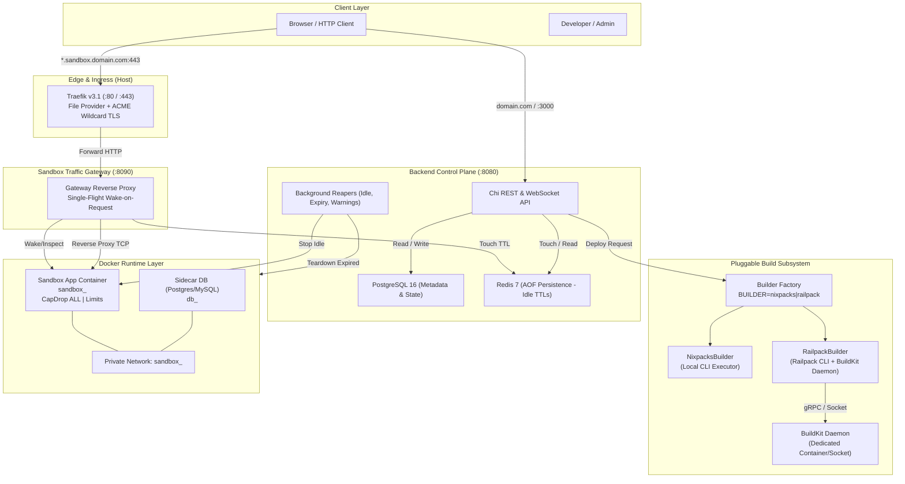
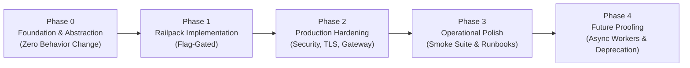

# PRD: Safe Evolution of api-sandbox-links — Builder Abstraction, Railpack Migration & Production Readiness

**Status:** Phase 0, Phase 1 & Phase 2 Complete; Ready for Phase 3 (Operational Polish & Runbooks)  
**Authors:** Senior Engineering  
**Date:** 2026-11-12  
**Target Repository:** https://github.com/jevitapearl/api-sandbox-links  
**Related Documents:**
- [`docs/ARCHITECTURE.md`](file:///home/swordrookie/projects/api_sandbox_links/api-sandbox-links/docs/ARCHITECTURE.md)
- [`docs/SETUP.md`](file:///home/swordrookie/projects/api_sandbox_links/api-sandbox-links/docs/SETUP.md)
- [`docs/API.md`](file:///home/swordrookie/projects/api_sandbox_links/api-sandbox-links/docs/API.md)
- [`docs/DATABASE.md`](file:///home/swordrookie/projects/api_sandbox_links/api-sandbox-links/docs/DATABASE.md)
- [`backend/internal/orchestrator/build.go`](file:///home/swordrookie/projects/api_sandbox_links/api-sandbox-links/backend/internal/orchestrator/build.go)
- [`backend/internal/orchestrator/deploy.go`](file:///home/swordrookie/projects/api_sandbox_links/api-sandbox-links/backend/internal/orchestrator/deploy.go)
- [`backend/internal/config/config.go`](file:///home/swordrookie/projects/api_sandbox_links/api-sandbox-links/backend/internal/config/config.go)
- [`backend/internal/proxy/wake_middleware.go`](file:///home/swordrookie/projects/api_sandbox_links/api-sandbox-links/backend/internal/proxy/wake_middleware.go)

---

## 1. Executive Summary & Problem Statement

### 1.1 Context
`api-sandbox-links` is a single-host platform that transforms public GitHub repositories into disposable, time-bounded, shareable sandboxes. The complete development lifecycle functions end-to-end:
1. Shallow clone of source repository into an isolated host directory (`SANDBOX_WORK_DIR`).
2. Sidecar database auto-provisioning (PostgreSQL 16 or MySQL 8) based on repository dependency detection.
3. Analysis and container build using Nixpacks (`nixpacks plan` -> `nixpacks build`).
4. Sandbox execution on an isolated Docker bridge network with memory, CPU, PID limits, dropped Linux capabilities, and `no-new-privileges`.
5. Edge routing via Traefik (file provider) forwarding wildcard hostnames (`*.sandbox.localhost`) to an internal wake-on-request gateway (`:8090`).
6. Idle timeout tracking via Redis TTL keys and automatic container hibernation/reaping.
7. File tree editing, hot redeployment, and Git commit/push support.

### 1.2 Core Problem Statement
Despite a robust foundation, several structural and operational liabilities block real-world adoption and sustained maintainability:

1. **Nixpacks Maintenance Deprecation:**
   Nixpacks is in upstream maintenance mode (last significant release v1.41.0, Oct 2025). Language definitions, package managers, and toolchains are frozen. Railway itself has migrated its production build infrastructure to **Railpack** (BuildKit + Mise). Continuing to depend on Nixpacks exposes the platform to unpatched security CVEs and incompatibility with modern runtimes (Node 22+, Python 3.13+, Go 1.24+, Rust 2024 editions).

2. **Tight Coupling to Nixpacks in the Orchestrator:**
   The build lifecycle is hardcoded directly inside [`backend/internal/orchestrator/build.go`](file:///home/swordrookie/projects/api_sandbox_links/api-sandbox-links/backend/internal/orchestrator/build.go) and invoked by [`DeploySandbox`](file:///home/swordrookie/projects/api_sandbox_links/api-sandbox-links/backend/internal/orchestrator/deploy.go#L99-L215). There is no interface boundary for alternative build engines (Railpack, Dockerfile, Cloud Native Buildpacks), build caching layers, or remote execution workers.

3. **Build Attack Surface & Resource Contention:**
   Builds currently run synchronously on the host using `exec.CommandContext` under a local semaphore (`BUILD_CONCURRENCY`, default 2). An unoptimized build consumes host CPU and disk I/O, impacting active sandbox latency. Furthermore, untrusted build hooks execute with host user privileges.

4. **Production Readiness Gaps:**
   - **Gateway Concurrency & Wake Deduplication:** While [`wake_middleware.go`](file:///home/swordrookie/projects/api_sandbox_links/api-sandbox-links/backend/internal/proxy/wake_middleware.go#L135-L151) implements in-memory channel locking, wake errors fail to propagate to awaiting requests, and request context cancellation during wake is unhandled.
   - **Redis Persistence:** The dev Redis container lacks Append-Only File (AOF) persistence or host volumes; an unplanned restart wipes all active idle TTL keys, risking premature reaper triggers or stuck state.
   - **Public Edge Routing & TLS:** The system assumes plain HTTP on `sandbox.localhost`. Production deployment demands automated ACME TLS certificate resolution via Let's Encrypt with wildcard DNS.
   - **Operational Supervision:** Lack of standardized systemd service units, structured log export, and health monitoring scripts.

---

## 2. Goals & Non-Goals

### 2.1 Primary Goals
1. **Extensible Builder Interface:** Refactor `backend/internal/orchestrator` to decouple build planning and container image compilation behind a clean, mockable `Builder` interface.
2. **Dual-Engine Railpack Support:** Implement `RailpackBuilder` utilizing the `railpack` CLI and BuildKit backend, gated behind the `BUILDER=railpack` configuration flag, while retaining `BUILDER=nixpacks` as the default.
3. **Production Hardening on Linux:** Deliver a turnkey single-node production deployment blueprint:
   - Automated wildcard TLS via Traefik ACME (DNS-01 / HTTP-01).
   - Robust single-flight gateway wake with error broadcasting.
   - Redis AOF persistence and connection resilience.
   - Gated defense-in-depth container sandboxing (`SANDBOX_HARDENED`).
   - Standardized `systemd` units, log rotation, and backup runbooks.
4. **Preservation of System Invariants:** Maintain existing battle-tested mechanics:
   - Port discovery fallback probe matrix (`DiscoverPort`).
   - Sidecar database automatic detection and credential injection.
   - Activation-based lifetime timer rebate (`MarkSandboxActive`).
   - Clean resource reclamation by Docker labels on teardown or failure.

### 2.2 Secondary Goals
- **Build Performance & Image Footprint:** Leverage Railpack's Mise caching and BuildKit layer sharing to reduce image transfer size and repeat build durations by >=30%.
- **Future Distributed Topology Readiness:** Ensure interfaces for building and container dispatching do not preclude shifting to asynchronous workers or multi-node schedulers.

### 2.3 Non-Goals (Strictly Out of Scope)
- **Multi-Tenant Public SaaS Isolation:** Untrusted public multi-tenancy requires kernel-level VM/sandbox isolation (e.g., gVisor, Firecracker, Kata Containers). This project targets trusted or semi-trusted workloads (interviews, review environments, internal bug repros).
- **Distributed Scheduler / Kubernetes:** The platform will remain an efficient single-node system. Kubernetes or Nomad operators are explicitly out of scope.
- **Rewriting Edge Routing:** The custom Go wake gateway (`:8090`) and Traefik file-provider model (`dynamic.yml`) will remain intact; no switch to Traefik Docker labels.
- **Redesigning Frontend / Core User Experience:** Ephemeral lifetime reap, hibernation, Monaco-based file editor, and WebSocket stats/logs streaming will not change their API contract.

---

## 3. Success Metrics

| Dimension | Target Metric | Verification Method |
|---|---|---|
| **Backwards Compatibility** | 0 regressions under `BUILDER=nixpacks` | Automated regression test suite against existing sample repositories |
| **Builder Parity** | `BUILDER=railpack` successfully analyzes, builds, and boots canonical stacks (`heroku/node-js-sample`, Python FastAPI, Go Chi, Static HTML) | Automated end-to-end smoke test suite |
| **Build Performance** | >= 25% reduction in build time on warm cache; >= 20% reduction in image size for Node & Python | Benchmark comparison across 5 runs per builder |
| **Edge Gateway Reliability** | 0 duplicate wake executions under 50 concurrent requests to a hibernated sandbox; 100% accurate error status code delivery (503) on wake failure | Concurrent load test against gateway `/` |
| **Production Resilience** | System recovers cleanly from host restart: Redis recovers last-seen timestamps via AOF, Postgres preserves sandbox state, orphaned containers pruned | Reboot simulation script on test host |
| **Zero Resource Leaks** | No leaked disk workdirs, untagged images, or orphan Docker networks after failed builds or sandbox teardowns | Docker system disk usage and network audit script |

---

## 4. Architectural Target State

### 4.1 System Topology



### 4.2 Builder Abstraction Design

The builder contract isolates all tool-specific CLI invocations, environment sanitization, JSON schema unmarshaling, and port extraction behind the `Builder` interface in `backend/internal/orchestrator`:

```go
package orchestrator

import (
    "context"
    "io"
)

// BuildPlan contains the normalized analysis output required by the orchestrator.
type BuildPlan struct {
    Builder          string            `json:"builder"`           // "nixpacks" or "railpack"
    Provider         string            `json:"provider"`          // e.g. "node", "python", "go"
    StartCmd         string            `json:"start_cmd"`         // Container start command
    InternalPort     int               `json:"internal_port"`     // Resolved internal listening port
    DetectedLanguage string            `json:"detected_language"` // Primary language
    Variables        map[string]string `json:"variables"`         // Environment variables detected
}

// Builder represents an engine capable of analyzing source code and compiling it into an OCI image.
type Builder interface {
    // Name returns the canonical identifier (e.g. "nixpacks", "railpack").
    Name() string

    // PlanAnalyze inspects the checked-out source directory and produces a normalized BuildPlan.
    PlanAnalyze(ctx context.Context, dir string) (*BuildPlan, error)

    // BuildImage compiles the source code in dir into an image tagged name, streaming output to progress.
    BuildImage(ctx context.Context, dir, name string, progress io.Writer) (string, error)
}
```

#### Factory Pattern
A factory method creates the configured builder during backend initialization in `backend/cmd/server/main.go` and injects it into `Orchestrator` and `Deployer`:

```go
func NewBuilder(cfg *config.Config, logger *slog.Logger) (Builder, error) {
    switch strings.ToLower(cfg.Builder) {
    case "nixpacks", "":
        return NewNixpacksBuilder(cfg.NixpacksBin, logger), nil
    case "railpack":
        return NewRailpackBuilder(cfg.RailpackBin, cfg.BuildKitHost, logger), nil
    default:
        return nil, fmt.Errorf("unsupported builder: %q (supported: nixpacks, railpack)", cfg.Builder)
    }
}
```

---

## 5. Phased Implementation Plan



### Phase 0: Foundations & Builder Abstraction (Week 1)
**Objective:** Refactor existing Nixpacks logic behind the `Builder` interface with zero regression or runtime divergence.

- **Tasks:**
  1. Define `Builder` and normalized `BuildPlan` in [`backend/internal/orchestrator/builder.go`](file:///home/swordrookie/projects/api_sandbox_links/api-sandbox-links/backend/internal/orchestrator/).
  2. Implement `NixpacksBuilder` in `backend/internal/orchestrator/builder_nixpacks.go`, moving `PlanAnalyze`, `BuildImage`, `nixpacksEnv`, and `detectPort`.
  3. Add `BUILDER` configuration key to [`backend/internal/config/config.go`](file:///home/swordrookie/projects/api_sandbox_links/api-sandbox-links/backend/internal/config/config.go) (default: `"nixpacks"`).
  4. Inject `Builder` into `Orchestrator` and `Deployer`.
  5. Update `DeploySandbox` to record builder identity in the `build_config` JSON column:
     ```json
     {"builder": "nixpacks", "provider": "node", "port": 3000, "start": "npm start"}
     ```
  6. Add unit tests for builder factory, config validation, and Nixpacks plan parsing.
  7. Update [`docs/ARCHITECTURE.md`](file:///home/swordrookie/projects/api_sandbox_links/api-sandbox-links/docs/ARCHITECTURE.md) and [`backend/.env.example`](file:///home/swordrookie/projects/api_sandbox_links/api-sandbox-links/backend/.env.example).
- **Exit Criteria:** All unit tests pass; deployment behavior on local dev is 100% bit-for-bit identical.

---

### Phase 1: Railpack Implementation Behind Flag (Week 2)
**Objective:** Add complete Railpack support while keeping Nixpacks default.

- **Tasks:**
  1. Implement `RailpackBuilder` in `backend/internal/orchestrator/builder_railpack.go`:
     - Invokes `railpack plan <dir> --json`.
     - Maps Railpack JSON output schema to normalized `BuildPlan`.
     - Handles environment allowlist (`RAILPACK_*`, `PATH`, tool versions).
     - Invokes `railpack build <dir> --name <tag>` with `BUILDKIT_HOST` forwarding.
  2. Add configuration keys in [`backend/internal/config/config.go`](file:///home/swordrookie/projects/api_sandbox_links/api-sandbox-links/backend/internal/config/config.go):
     - `RAILPACK_BIN` (default: `"railpack"`).
     - `BUILDKIT_HOST` (default: `"unix:///var/run/buildkit/buildkitd.sock"`).
  3. Support BuildKit daemon in `docker-compose.dev.yml` as an optional service.
  4. Build a test matrix with golden fixtures for Railpack JSON outputs:
     - Node.js (package.json + lockfile).
     - Python (requirements.txt / pyproject.toml).
     - Go (go.mod).
     - Static web assets.
  5. Validate port extraction: Map Railpack's detected or configured port, falling back to `DiscoverPort` active TCP probing.
- **Exit Criteria:** `BUILDER=railpack` successfully builds and serves `heroku/node-js-sample` and a Python FastAPI test repo. `BUILDER=nixpacks` remains unaffected.

---

### Phase 2: Production Hardening (Week 3)
**Objective:** Address edge security, proxy concurrency, and operational durability.

- **Tasks:**
  1. **Gateway Single-Flight & Error Propagation:**
     Refactor [`wake_middleware.go`](file:///home/swordrookie/projects/api_sandbox_links/api-sandbox-links/backend/internal/proxy/wake_middleware.go#L135-L151) using `golang.org/x/sync/singleflight` or dedicated result channels:
     - Concurrent requests share a single wake operation.
     - If wake fails, all waiting requests receive HTTP 503 with the specific error cause.
     - Context cancellation of waiting requests does not cancel the background wake for others.
  2. **Redis Durability:**
     - Enable AOF in Redis: `command: ["redis-server", "--appendonly", "yes", "--appendfsync", "everysec"]`.
     - Attach a dedicated Docker volume to prevent data loss across restarts.
  3. **Container Sandbox Hardening Flag (`SANDBOX_HARDENED`):**
     - Make isolation policy in [`lifecycle.go`](file:///home/swordrookie/projects/api_sandbox_links/api-sandbox-links/backend/internal/orchestrator/lifecycle.go#L80-L98) configurable.
     - Add `--init` (`Init: true` in `HostConfig`) to eliminate zombie processes.
     - Support optional Read-Only Root Filesystem (`ReadonlyRootfs: true`) with `/tmp` and `/run` tmpfs mounts for compatible runtimes.
     - Optional `SANDBOX_RUNTIME` configuration for hosts with `runsc` (gVisor).
  4. **Traefik Production Wildcard Ingress & TLS:**
     - Provide production Traefik configuration (`traefik/traefik.prod.yml`) featuring Let's Encrypt ACME with DNS-01 challenge support for `*.sandbox.yourdomain.com`.
     - Automatic HTTP->HTTPS redirect.
  5. **Gateway Rate Limiting & Safety Limits:**
     - Protect `:8090` gateway with IP-based and subdomain-based rate limiting via Chi middleware.
     - Enforce `http.MaxBytesReader` (default 32MB) on upload/payload bodies.
- **Exit Criteria:** Wake storms handled gracefully without duplicated wakes; Redis state survives container restart; wildcard HTTPS functions on real domain.

---

### Phase 3: Operational Safety Net & Smoke Harness (Week 4)
**Objective:** Guarantee regression resistance and streamline single-node management.

- **Tasks:**
  1. **Automated End-to-End Smoke Test:**
     - Create `backend/test/e2e/smoke_test.go` executed via `go test -tags=smoke`:
       - Clones public sample repo.
       - Triggers deploy via backend API (`POST /api/sandboxes`).
       - Polls status to `running`.
       - Issues HTTP GET through gateway port (`:8090`) to verify healthy 200 OK response.
       - Tests hibernate and wake cycle.
       - Teardowns sandbox and verifies zero orphan Docker artifacts.
     - Runs sequentially against both `BUILDER=nixpacks` and `BUILDER=railpack`.
  2. **WebSocket Idle TTL Refresh:**
     - Ensure active WebSocket terminal/logs connections refresh the Redis idle key (`lr:<sandbox_id>`), preventing sandboxes from hibernating while an interactive session is open.
  3. **Database-Backed Build Queue Enhancements:**
     - Upgrade deploy slot reservation logic to gracefully handle worker process restarts, marking stuck `queued` or `building` entries as failed after heartbeat expiration.
  4. **Production Runbook & Systemd Units:**
     - Provide `systemd/api-sandbox-backend.service`.
     - Create maintenance scripts: disk prune, orphan network cleanup, database backup, and encryption key rotation procedures.
- **Exit Criteria:** E2E smoke test runs and passes in under 4 minutes; complete Linux host deployment documentation verified on a fresh Debian/Ubuntu instance.

---

### Phase 4: Future-Proofing & Builder Deprecation (Post-Launch)
**Objective:** Assess deprecation of Nixpacks and evaluate distributed scaling.

- **Tasks:**
  1. Gather telemetry on build failure rates, build duration, and cache hit ratio comparing Railpack vs Nixpacks across real-world workloads.
  2. Switch default `BUILDER` to `"railpack"` in configuration.
  3. Mark Nixpacks as deprecated with an administrative warning in API responses and logs.
  4. Abstract the wake and routing coordinator behind an interface to allow container execution on remote worker nodes.
- **Exit Criteria:** Railpack operational default with >99% build parity; Nixpacks cleanly deprecated.

---

## 6. Technical Specifications & Interface Contracts

### 6.1 Configuration Surface (`backend/internal/config/config.go`)

The following environment variables will be added:

| Variable | Type | Default | Description |
|---|---|---|---|
| `BUILDER` | `string` | `"nixpacks"` | Active builder implementation: `"nixpacks"` or `"railpack"` |
| `RAILPACK_BIN` | `string` | `"railpack"` | Absolute path or binary name for the Railpack CLI |
| `BUILDKIT_HOST` | `string` | `"unix:///var/run/buildkit/buildkitd.sock"` | Connection endpoint for the BuildKit daemon |
| `SANDBOX_HARDENED` | `bool` | `false` | Enable enhanced sandbox hardening (`ReadonlyRootfs`, strict tmpfs) |
| `SANDBOX_INIT` | `bool` | `true` | Use Docker `--init` (tini) to reap zombies in app containers |
| `SANDBOX_RUNTIME` | `string` | `""` | Optional container runtime (e.g. `"runsc"` for gVisor) |
| `GATEWAY_RATE_LIMIT_RPS` | `int` | `100` | Gateway request-per-second rate limit per client IP |
| `GATEWAY_RATE_LIMIT_BURST`| `int` | `200` | Gateway burst rate limit capacity |

### 6.2 Gateway Wake Single-Flight Contract

The current wake implementation in [`wake_middleware.go`](file:///home/swordrookie/projects/api_sandbox_links/api-sandbox-links/backend/internal/proxy/wake_middleware.go) will be replaced with a single-flight group that stores both completion and error state:

```go
type wakeResult struct {
    err error
}

type wakeCall struct {
    wg   sync.WaitGroup
    res  wakeResult
}

type Gateway struct {
    // ...
    wakeMu    sync.Mutex
    wakeCalls map[string]*wakeCall
}

func (g *Gateway) wake(ctx context.Context, sandbox *db.Sandbox) error {
    g.wakeMu.Lock()
    if call, ok := g.wakeCalls[sandbox.ID]; ok {
        g.wakeMu.Unlock()
        // Wait for active wake or caller context cancellation
        select {
        case <-ctx.Done():
            return ctx.Err()
        case <-callDone(call):
            return call.res.err
        }
    }

    call := &wakeCall{}
    call.wg.Add(1)
    g.wakeCalls[sandbox.ID] = call
    g.wakeMu.Unlock()

    go func() {
        // Dedicated background wake context so client disconnection doesn't abort container boot
        wakeCtx, cancel := context.WithTimeout(context.Background(), wakeTimeout)
        defer cancel()

        err := g.executeWake(wakeCtx, sandbox)

        g.wakeMu.Lock()
        call.res = wakeResult{err: err}
        delete(g.wakeCalls, sandbox.ID)
        call.wg.Done()
        g.wakeMu.Unlock()
    }()

    select {
    case <-ctx.Done():
        return ctx.Err()
    case <-callDone(call):
        return call.res.err
    }
}
```

### 6.3 Data Model & Database Migration

No breaking schema changes are required. The existing JSONB/text column `build_config` in the `sandboxes` table will store the builder identifier alongside provider metadata:

```json
{
  "builder": "railpack",
  "provider": "nodejs",
  "port": 3000,
  "start": "node index.js",
  "build_time_ms": 14200,
  "cache_hit": true
}
```

The `deployments` table's `log_excerpt` column will capture standardized build logs from either tool, bounded to 4000 characters as previously implemented.

---

## 7. Risk Analysis & Mitigation Matrix

| Risk | Severity | Likelihood | Mitigation Strategy |
|---|---|---|---|
| **Railpack Plan Schema Incompatibility** | High | Medium | Implement comprehensive golden schema tests with raw JSON fixtures; fallback to standard `DiscoverPort` active TCP port probing (90s window). |
| **BuildKit Daemon Out-of-Memory / Disk Exhaustion** | High | Medium | Configure BuildKit garbage collection thresholds (`GCKeepStorage=20GB`); run `docker-compose.dev.yml` / production systemd with automated daily prune cron. |
| **Regression in Existing Nixpacks Path** | Critical | Low | Phase 0 is a pure refactor without behavior changes. Code changes validated against existing integration tests before any Railpack code is merged. |
| **Container Hardening Breaks Complex Apps** | Medium | Medium | Strict security settings (`ReadonlyRootfs`) gated behind `SANDBOX_HARDENED=false` default. Retain `CapAdd: NET_BIND_SERVICE` for port 80 binding. |
| **Traefik ACME Rate Limiting** | Medium | Low | Use Let's Encrypt Staging environment during test/staging setup; mandate wildcard DNS (`*.sandbox.domain.com`) to consume only 1 certificate for all sandboxes. |
| **Documentation & Operational Drift** | Low | High | Mandatory PR review rule: every change altering environment variables, CLI tools, or architecture must update `ARCHITECTURE.md`, `SETUP.md`, and `.env.example` in the same commit. |

---

## 8. Resolution of Strategic Open Questions

### Question 1: Should we support both builders indefinitely, or plan a deprecation window for Nixpacks once Railpack is proven?
**Recommendation: Phased 90-Day Deprecation Window.**
- *Phase 1-2:* Support both; Nixpacks is default (`BUILDER=nixpacks`).
- *Phase 3:* Railpack becomes default (`BUILDER=railpack`); Nixpacks retained as fallback.
- *Phase 4 (T+90 days):* Deprecate Nixpacks. Maintaining two build orchestrators long-term doubles the maintenance burden, test matrix, and image dependencies. Nixpacks is officially end-of-life; once Railpack demonstrates parity on common stacks, Nixpacks should be removed.

### Question 2: Preferred BuildKit deployment model for production (local privileged container vs. rootless vs. external)?
**Recommendation: Dedicated Rootless BuildKit Container on Host Bridge.**
- Deploy `moby/buildkit:v0.19.0-rootless` via Docker Compose / systemd, exposing a UNIX domain socket (`/run/buildkit/buildkitd.sock`) or loopback TCP (`127.0.0.1:1234`).
- Avoids granting privileged Docker access to the build daemon while preventing noisy-neighbor interference with host Docker daemon builds.
- Configure dedicated cache volume with strict GC limits (e.g. 25GB max storage).

### Question 3: How aggressively should we default to hardened container flags?
**Recommendation: Safe-by-Default, Opt-in for Strict Immutability.**
- *Active by Default:* Capabilities drop (`CapDrop: ALL`), `no-new-privileges`, CPU/Memory quotas, PID limits, and `Init: true` (tini). This is already largely in place and verified safe.
- *Opt-In via `SANDBOX_HARDENED=true`:* Read-only root filesystem (`ReadonlyRootfs: true`). Many legacy applications and frameworks write to random application subdirectories at startup; enabling read-only rootfs by default would cause widespread deploy failures.

### Question 4: Is there appetite for a minimal multi-host design in the next 3–6 months, or stay single-host for the foreseeable future?
**Recommendation: Stay Single-Host, Interface-Isolated.**
- Prematurely introducing distributed clustering (Nomad/K8s/swarm) adds immense operational complexity (distributed networking, remote volume synchronization, multi-node Traefik routing).
- Keep single-host simplicity, but ensure interfaces (`Builder`, `Runner`, `Gateway`) remain decoupled from local disk paths.

### Question 5: Do we want the automated smoke test to run in CI (requires Docker-in-Docker or a dedicated runner)?
**Recommendation: Yes, on a Self-Hosted / Dedicated Linux Runner with Docker Socket Access.**
- Running smoke tests with Docker-in-Docker (DinD) in standard GitHub-hosted runners is notoriously slow and brittle.
- Utilize a dedicated GitHub Actions Runner or run smoke tests during deployment verification using the host's native Docker socket `/var/run/docker.sock`.

---

## 9. Immediate Action Items (Sprint 1)

1. **Implement Phase 0 PR:**
   - Create `backend/internal/orchestrator/builder.go` and `builder_nixpacks.go`.
   - Wire `Builder` interface into `Deployer` and `Orchestrator`.
   - Update config and `.env.example`.
2. **Build Smoke Test Harness:**
   - Write `backend/test/e2e/smoke_test.go` targeting `heroku/node-js-sample`.
   - Verify complete deploy -> wake -> reap cycle against baseline Nixpacks.
3. **Railpack Schema Spike:**
   - Execute `railpack plan` against 4 standard repositories (Node, Python, Go, Rust) and document output JSON schemas.
4. **Production Runbook Draft:**
   - Publish systemd service definitions and Traefik Let's Encrypt DNS-01 configuration guide in `docs/PRODUCTION.md`.

